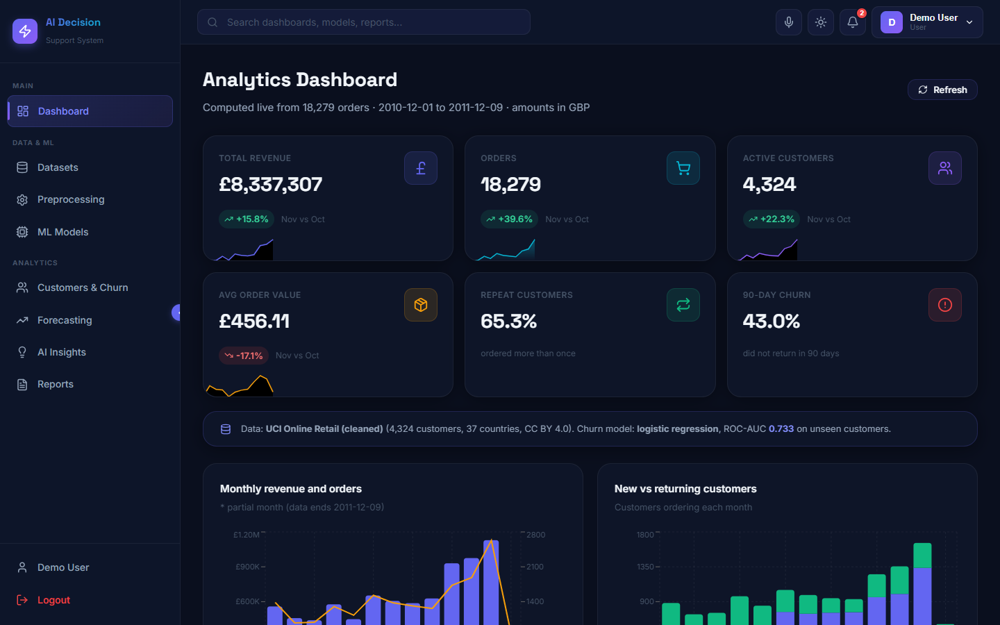
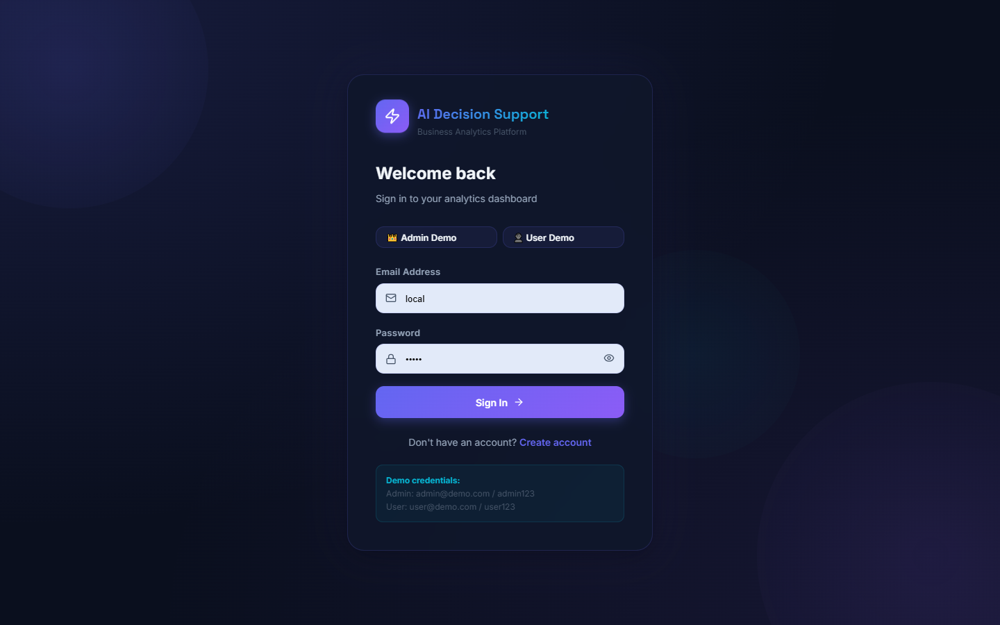
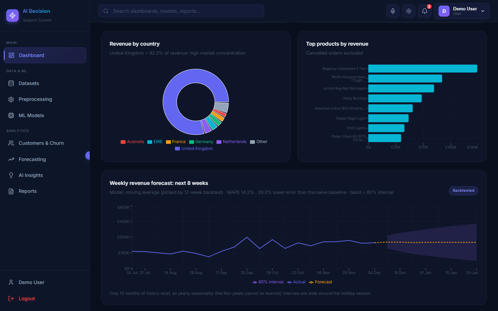
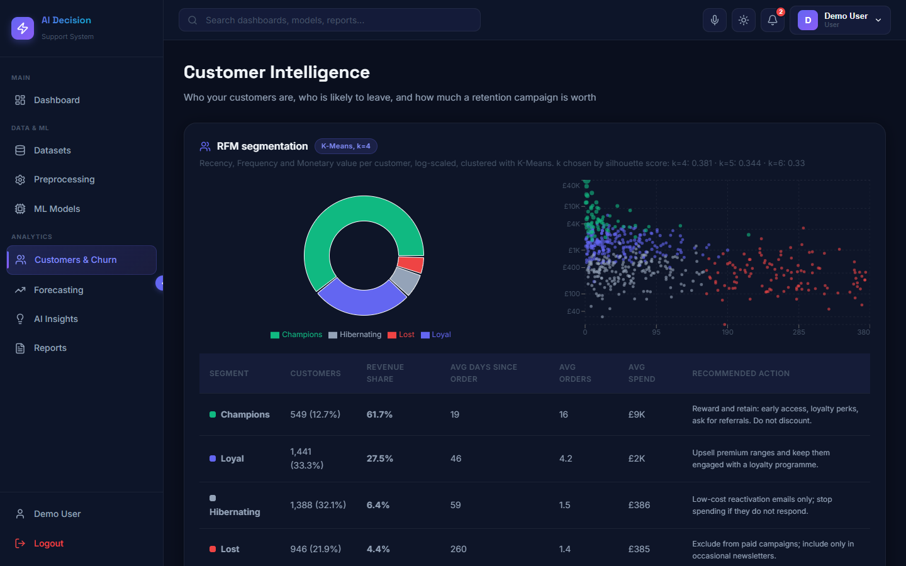
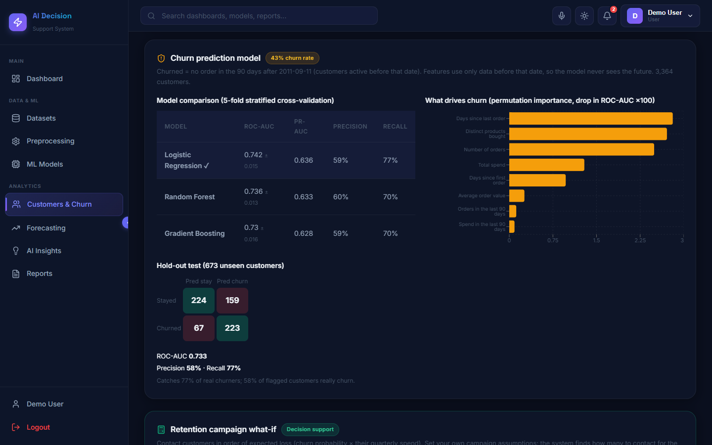
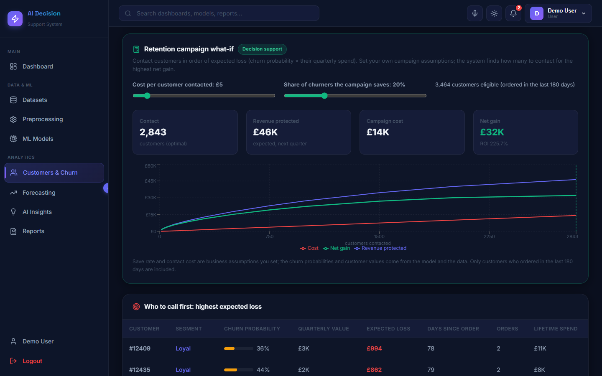
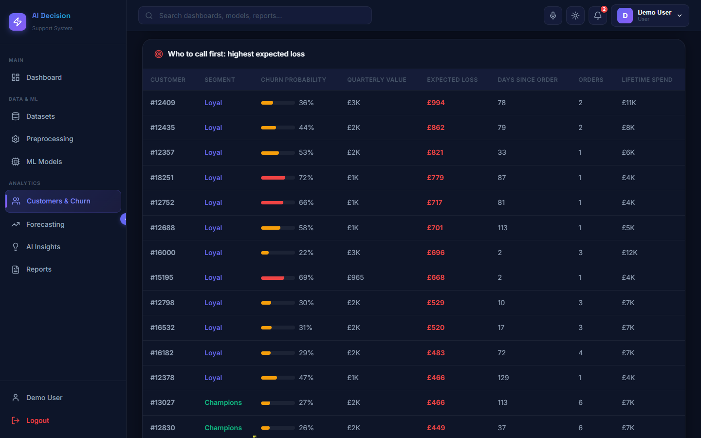
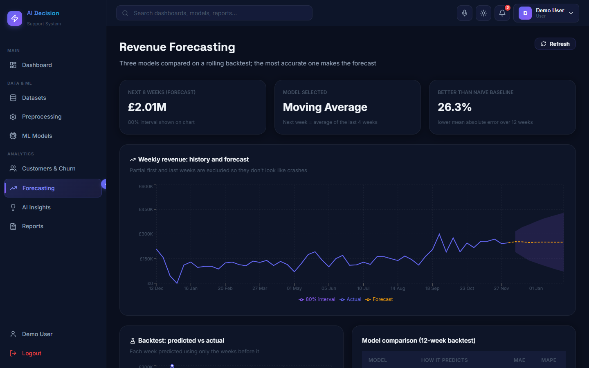
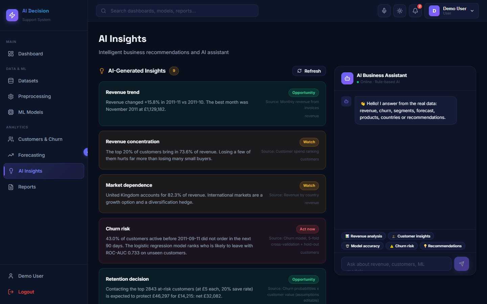
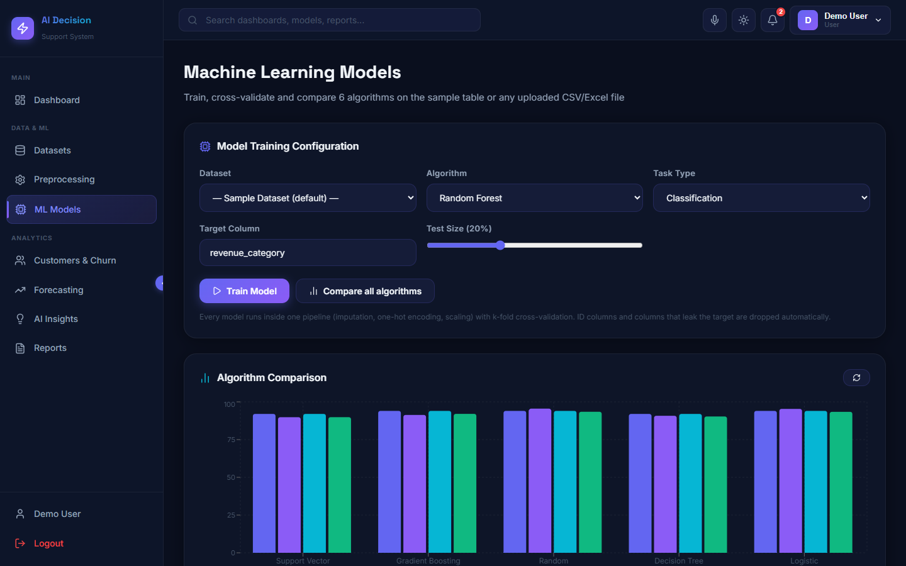

# AI-Driven Decision Support System for Retail Analytics


A full-stack decision support system that turns raw e-commerce transactions into decisions:
**which customers are about to leave, which ones are worth saving, how much a retention campaign
should cost, and what revenue to expect next.**

It runs on a **real public dataset** (UCI Online Retail: 541,909 invoice lines from a UK online
retailer, Dec 2010 – Dec 2011). Every number in the app is computed from that data or from a model
trained on it. Nothing is hardcoded.



## Contents

- [Key results](#key-results)
- [Screenshots](#screenshots)
- [Features](#features)
- [How it works](#how-it-works)
- [Architecture](#architecture)
- [Tech stack](#tech-stack)
- [Project structure](#project-structure)
- [Getting started](#getting-started)
- [API overview](#api-overview)
- [Testing](#testing)
- [Limitations and next steps](#limitations-and-next-steps)
- [Data credit](#data-credit)

## Key results

All figures are produced by the app and checked by the test suite.

| Area | Method | Result |
|---|---|---|
| Data cleaning | Drop lines without a customer ID, cancellations, the orders those cancellations reverse, and non-product lines | 541,909 → 393,532 lines · 18,279 orders · 4,324 customers · 37 countries · £8.34M revenue |
| Churn prediction (90-day) | Time-based labels, 10 behavioural features, Logistic Regression vs Random Forest vs Gradient Boosting, 5-fold stratified CV | **ROC-AUC 0.742 ± 0.015** (Logistic Regression); hold-out ROC-AUC 0.733, recall 77%, precision 58%; base churn rate 43% |
| Customer segmentation | RFM features (log-scaled) + K-Means, k chosen by silhouette score | k = 4 (silhouette 0.38). "Champions" are 12.7% of customers but **61.7% of revenue** |
| Revenue forecasting | Naive vs 4-week moving average vs Ridge on lags, 12-week rolling backtest | **MAPE 14.2%**, 26% lower error than the naive baseline |
| Retention decision | Expected loss = churn probability × quarterly spend; sweep over campaign size | At £5 per contact and a 20% save rate: contact 2,843 customers, protect ≈ £46K for £14K, **net ≈ £32K** |
| Business facts | Pareto and market concentration | Top 20% of customers = 73.6% of revenue; UK = 82.3% of revenue |

A ROC-AUC of about 0.74 is typical for churn models that use purchase behaviour alone. The numbers
are reported on customers the model never saw during training.

## Screenshots

| | |
|---|---|
| **Login**  | **Dashboard: countries, products, forecast**  |
| **Customer segments (RFM + K-Means)**  | **Churn model comparison and drivers**  |
| **Retention campaign what-if**  | **Ranked call list**  |
| **Backtested revenue forecast**  | **Insights and data assistant**  |
| **ML workbench**  | |

## Features

- **Analytics dashboard**: revenue, orders, active customers, average order value, repeat rate and
  churn rate. Month-over-month change uses complete months only. Also: monthly trend, new vs
  returning customers, revenue by country, top products, and a weekly forecast with an 80% band.
- **Customer intelligence**
  - RFM segments, each with a recommended marketing action
  - Churn model comparison, hold-out confusion matrix and permutation feature importance
  - **Retention what-if**: set cost per contact and save rate, and the system finds the campaign
    size with the highest net gain
  - A ranked call list of customers with the highest expected loss
- **Forecasting**: the backtest behind the forecast, predicted vs actual, and MAE/MAPE for each model.
- **Insights and assistant**: insights generated from computed facts, each showing where its number
  comes from. The assistant answers from the same numbers, so it cannot invent figures.
- **ML workbench**: upload any CSV/Excel file, pick a target, and train or compare 6 algorithms.
  Everything runs in one scikit-learn pipeline (imputation, one-hot encoding, scaling, model) with
  k-fold cross-validation. An automatic **leakage guard** drops ID columns, dates and columns the
  target is derived from. Saved models predict directly from raw input.
- **Reports**: one-click PDF and Excel reports with KPIs, model comparison, segments and insights.
- **Security**: JWT authentication with user and admin roles, bcrypt password hashing, per-user data
  isolation, an activity log and an admin panel.
- **Accessibility**: charts and counters respect the operating system's "reduce motion" setting.

## How it works

1. **Cleaning** (`backend/scripts/prepare_online_retail.py`): removes lines without a customer and
   removes cancellations together with the original order lines they reverse. Without this, one
   80,995-unit order that was cancelled the same day would appear as the top product. It also
   removes postage and fee lines and computes revenue.
2. **Churn** (`ml_engine/churn.py`): cutoff = last date minus 90 days. Features use only orders
   before the cutoff; the label is "no order in the 90 days after". Three models are compared with
   5-fold stratified CV, the best is checked on a 20% hold-out, then every customer is scored on
   the full history.
3. **Segmentation** (`ml_engine/segmentation.py`): Recency, Frequency and Monetary value per
   customer, log-transformed and scaled, then clustered with K-Means for k = 4–6. The k with the best
   silhouette score is used. Segments are named by comparing each centroid with the median customer.
4. **Forecast** (`ml_engine/forecast.py`): weekly revenue; each of the last 12 weeks is predicted
   from earlier weeks only. The model with the lowest error is used, and the 80% interval comes
   from its backtest errors.
5. **Retention what-if**: customers are sorted by expected loss. Contacting the first N saves
   `Σ expected loss × save rate` and costs `N × contact cost`. The N with the maximum net gain is
   recommended.

Heavy work runs once in a background thread at startup and is cached to disk, keyed by the data
file's timestamp, so later starts load in under a second.

## Architecture

```
React (Vite, Recharts) ──REST + JWT──► FastAPI
                                        ├─ /api/analytics  → ml_engine/data_engine   (KPIs, trends)
                                        │                    ml_engine/forecast      (backtested forecast)
                                        ├─ /api/decisions  → ml_engine/segmentation  (RFM + K-Means)
                                        │                    ml_engine/churn         (models, what-if)
                                        ├─ /api/insights   → ml_engine/insights      (facts → text)
                                        ├─ /api/ml         → ml_engine/trainer       (generic workbench)
                                        ├─ /api/reports    → ReportLab / OpenPyXL
                                        └─ /api/auth, /api/admin, /api/datasets
SQLite: users, datasets, model runs, logs · Trained models and cached results: backend/saved_models/
```

## Tech stack

| Layer | Tools |
|---|---|
| Backend | Python, FastAPI, SQLAlchemy (SQLite), python-jose (JWT), passlib/bcrypt |
| Data & ML | pandas, NumPy, scikit-learn, joblib |
| Frontend | React 19, Vite, Recharts, lucide-react, axios |
| Reports | ReportLab (PDF), OpenPyXL (Excel) |
| Quality & ops | pytest, Docker, Docker Compose |

## Project structure

```
ai-decision-support/
├── backend/
│   ├── main.py                  # FastAPI app, routers, startup warm-up
│   ├── database.py              # SQLAlchemy models and seeding
│   ├── api/                     # REST endpoints (analytics, decisions, ml, reports, auth, admin)
│   ├── ml_engine/
│   │   ├── data_engine.py       # loading, KPIs, monthly series, RFM, disk cache
│   │   ├── churn.py             # churn features, model comparison, retention what-if
│   │   ├── segmentation.py      # RFM + K-Means segments
│   │   ├── forecast.py          # weekly forecast with rolling backtest
│   │   ├── insights.py          # insights and assistant from computed facts
│   │   └── trainer.py           # generic pipeline, leakage guard, CV
│   ├── scripts/prepare_online_retail.py
│   ├── tests/                   # 23 pytest tests
│   └── datasets/sample_business_data.csv
├── frontend/src/
│   ├── pages/                   # Dashboard, Customers & Churn, Forecasting, Insights, ML, Reports…
│   ├── components/              # layout and KPI card
│   └── services/api.js          # API client
├── docs/screenshots/
└── docker-compose.yml
```

## Getting started

**Requirements:** Python 3.12+ and Node.js 20+.

**1. Backend**
```bash
cd backend
python -m venv .venv
.venv\Scripts\activate            # Windows   (macOS/Linux: source .venv/bin/activate)
pip install -r requirements.txt
copy .env.example .env            # optional  (macOS/Linux: cp .env.example .env)
```

**2. Data (one time).** Download *Online Retail* from
https://archive.ics.uci.edu/dataset/352/online+retail (CC BY 4.0), unzip it, then run:
```bash
python scripts/prepare_online_retail.py "path/to/Online Retail.xlsx"
```
This writes `datasets/online_retail_clean.csv.gz` and prints a cleaning summary.

**3. Start the API**
```bash
uvicorn main:app --reload
```
The first start trains the models in about 1–2 minutes; after that, startup is instant.
Interactive API docs: http://localhost:8000/docs

**4. Frontend**
```bash
cd frontend
npm install
npm run dev
```
Open http://localhost:5173 and use the **User Demo** or **Admin Demo** button
(`user@demo.com` / `user123`, `admin@demo.com` / `admin123`). Change or remove these demo accounts
before any real deployment.

**Docker.** Set `SECRET_KEY` first (in production the API refuses to start without it), then:
```bash
docker-compose up --build
```

## API overview

All endpoints except login and register need a `Bearer` token. Full interactive docs are at `/docs`.

| Endpoint | Purpose |
|---|---|
| `POST /api/auth/login` · `register` · `GET /api/auth/me` | Authentication |
| `GET /api/analytics/dashboard` · `monthly` · `countries` · `products` · `heatmap` · `forecast` | Dashboard analytics |
| `GET /api/decisions/segments` | RFM segments with recommended actions |
| `GET /api/decisions/churn` | Churn model comparison, hold-out metrics, feature importance |
| `GET /api/decisions/at-risk?limit=25` | Customers ranked by expected loss |
| `GET /api/decisions/retention-plan?contact_cost=5&save_rate=0.2` | Retention what-if |
| `POST /api/ml/train` · `compare-run` · `predict` | ML workbench |
| `GET /api/insights/` · `POST /api/insights/chat` | Insights and assistant |
| `POST /api/reports/generate` · `GET /api/reports/{id}/download` | PDF / Excel reports |
| `POST /api/datasets/upload` · `GET /api/datasets/{id}/preview` | Upload and preview data |

## Testing

```bash
cd backend
pytest -q
```

The 23 tests check that:
- revenue totals match the raw data, and month-over-month uses complete months only
- the forecast beats the naive baseline and its interval contains the forecast
- segments cover every customer exactly once
- the churn model uses only past data and beats chance
- the retention recommendation is the true optimum
- the leakage guard drops ID and target-derived columns
- saved pipelines predict from raw input, and every API endpoint and report responds

## Limitations and next steps

- One year of history, so yearly seasonality (the November peak) cannot be learned; forecast
  intervals are wide around the holidays. Next: two or more years of data.
- Churn uses purchase behaviour only; adding email engagement or support data would raise accuracy.
- Save rate and contact cost in the what-if are assumptions. Next: measure the real save rate with
  an A/B test.
- No margin data, so customer value is revenue-based rather than profit-based.
- SQLite and in-process training suit a prototype. Production would use PostgreSQL, scheduled
  retraining and drift monitoring.
- The 50-row `sample_business_data.csv` is only a demo table for the ML workbench; its scores are
  not meaningful results.

## Data credit

Chen, D. (2015). *Online Retail* [Dataset]. UCI Machine Learning Repository.
https://doi.org/10.24432/C5BW33 — licensed under CC BY 4.0.

## Author

**Rama Bharti** · [GitHub](https://github.com/ramabharti8) · [LinkedIn](https://linkedin.com/in/ramabharti)

Built as my MBA (Data Science & AI) capstone at SRM Institute of Science and Technology, then rebuilt on
real data with full validation (version 2).
